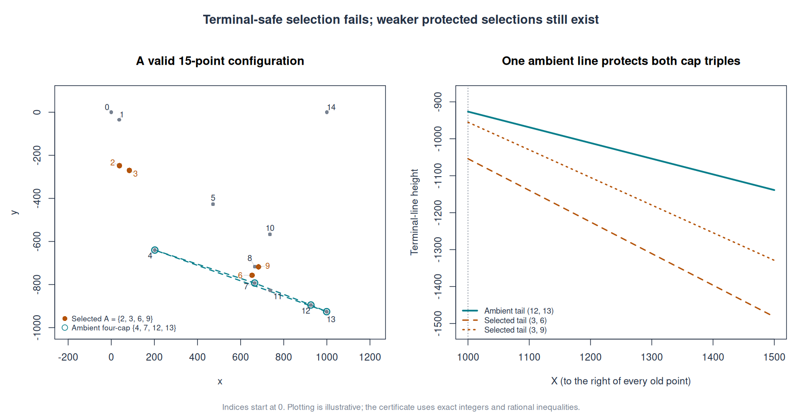

# A real fifteen-point terminal-safe obstruction

**CERTIFIED finite contradiction, independently audited exact geometry,
and PROVED Lean real-geometry obstruction.** This example has no five-cap and
no convex seven-gon, but no terminal-safe weak Delta. It improves the
previous eighteen-point example. It does **not** refute weak Delta,
rooted weak Delta, or uniform-envelope selection. No global minimum size
or novelty claim is made in this fixed-instance record.

Indices are zero based in increasing x order. A weak Delta is a subset
with no four-cap that meets every whole convex hexagon. Terminal safety
requires each selected cap triple's last pair to be the last pair of an
ambient four-cap. This sufficient extension condition is stronger than
uniform-envelope protection.

## Readable realization

```text
0=(0,0)       1=(37,-35)    2=(38,-248)   3=(84,-270)
4=(202,-640)  5=(472,-427)  6=(653,-757)  7=(665,-793)
8=(666,-717)  9=(683,-718) 10=(736,-567) 11=(737,-827)
12=(926,-895) 13=(999,-926) 14=(1000,0)
```

All 455 determinants are nonzero, with minimum absolute value 45. Every
sign agrees with the original integer realization of the SAT model.
There are 48 four-caps, no five-caps, 187 convex hexagons, no convex
heptagons, and 78 terminal-unprotected cap triples. Maximum cap, cup and
convex-polygon sizes are respectively 4, 6 and 6. These are **COMPUTED
exact** facts, independently checked in
[the balanced-coordinate audit](../model15_audit/balanced/README.md).

The [original coordinates](data/original.json),
[readable coordinates](data/balanced.json), and
[point file](data/balanced.points) are retained. The numerical realization
search was HEURISTIC; only exact integer acceptance supplies evidence.



The [SVG](figure/terminal15.svg) is suitable for export. The figure was
made with base R by [plot_terminal15.R](../plot_terminal15.R); its plotted
coordinates were checked against the audited input. Floating-point
rendering carries no proof weight.

## The finite contradiction

Give each point a Boolean membership variable. For each four-cap, forbid
selecting all four vertices; for each unprotected cap triple, forbid all
three; for each hexagon, require at least one selected vertex. The
[membership formula](data/membership.cnf) has 15 variables and 313 clauses.
All 32,768 memberships also fail in an independent exact enumeration.

The readable and original coordinates produce byte-identical formulas:

```text
membership CNF SHA-256
7d18c713d190d893a4d3d7873e8caa7d45061326c403ee8133888382040cc22a
binary LRAT SHA-256
1f25c0cbe8988577fecbfaf9379ffde400bca45d047cee6ce15bf3391bf94cef
```

The retained [proof](data/membership.blrat) has an exact cake_lpr
`s VERIFIED UNSAT` verdict in [the log](data/membership.cake.log), and a
separate replay is recorded in [the independent model audit](../model15_audit/README.md).

A greedy reduction leaves [98 original clauses](core/core.cnf): 36
negative triple clauses and 62 positive hexagon clauses. No four-cap
clause is needed in this core. Its [decision tree](core/tree.json) has
85 nodes and 43 conflict leaves. Removing any one of its clauses admits
the retained [explicit membership witness](core/irredundancy_models.json).
This is irredundancy, **not minimum core size**. The parent separately
checked the core's exact original-clause inclusion and all 98 witnesses.

All 105 thirteen-point restrictions and all 15 fourteen-point restrictions
of this particular example have positive terminal-safe witnesses. A
separate parent checker replayed each witness, including all required
ambient terminal four-caps inside the restricted set; see
[subsets/replay.json](subsets/replay.json). With the separate through-12
theorem, every proper restriction of this example therefore has a
terminal-safe Delta. This restricted minimality does not establish
global fifteen-point minimality.

```text
98-clause core SHA-256
d04ad6b75aeec577d766842207040ad174ad2562fba3b96a0748da1dbc4f12f0
core binary LRAT SHA-256
e9572a48f8a8baf09577884901cba860456425f8c98284143f79597ab48a33a1
decision-tree SHA-256
5d91e4eb69b074ba20a9915b1c4d707347a749ca0d352671106e99c0a6675e77
```

The [core certificate](core-certificate/result.json) also has an exact
accepted cake_lpr verdict. Independently,
[Terminal15Boolean.lean](../lean/Terminal15Boolean.lean) proves core UNSAT
and the full 313-clause formula UNSAT for both Prop and Bool membership.
The explicit proof uses ordinary logical proof terms, with no
`native_decide`, `ofReduceBool`, `sorry`, or custom axiom. All three axiom
audits report only `propext`, `Classical.choice`, and `Quot.sound`. The
parent freshly replayed it in 11.818 seconds. See
[the frozen Lean packet](../lean/FINAL.md).

**Scope of the Boolean packet:** it concerns the exact displayed formula.
The subsequently completed [finite geometry](../lean_geometry/README.md)
and [real bridge](../lean_geometry/real_bridge/README.md) now formalize the
link to actual real points and the repository's convex-position predicate.
The main theorem is
`Delta3.Balanced15.RealBridge.balanced15_real_obstruction`.
Fresh [parent real replay](../lean_real_parent/README.md) checks all six
bridge modules and31 standard-only axiom reports. This proves the stated
fifteen-point existence result, not global minimality or ordinary weak
Delta failure. The geometric lower bound through13 remains separately
certified and audited, leaving the global minimum at14 or15.

## Why the weaker conjecture survives this example

There are 4,805 ordinary weak Deltas. The four smallest are the triples
`{2,3,7}`, `{2,3,11}`, `{4,11,12}`, and `{4,11,13}`. Every prescribed root
belongs to a weak Delta of size at most four. The fixed coordinates have
4,499 uniform-envelope Deltas and 1,842 Deltas satisfying the sufficient
cup-support rule. The same counts happen to hold in the original and
readable realizations; no constancy throughout the whole orientation cell
is inferred for the metric-dependent uniform count.

For an especially transparent cup-support certificate, choose
`A={2,3,6,9}`. It has no four-cap and hits every hexagon. Its only cap
triples are `(2,3,6)` and `(2,3,9)`. The ambient four-cap `(4,7,12,13)`
protects both, even though its last pair is different from both selected
last pairs. For `X=1000+t`, the protecting line minus each selected line is

```text
ell_(12,13)(X) - ell_(3,6)(X) = (17912*t + 5298805)/41537,
ell_(12,13)(X) - ell_(3,9)(X) = (14135*t + 1253383)/43727.
```

Both are strictly positive for all `t>=0`. The
[exact rational certificates](data/cup-certificates.json) include both
realizations. Thus this A extends safely by every rightmost
point whose addition preserves absence of five-caps. Existence of this
selector is also protected throughout the ordered orientation cell by
the written cup-support criterion. The parent independently rechecked
all four rational inequalities and all supporting orientation predicates.

## Reproduction and provenance

[archive_terminal15.py](../archive_terminal15.py) copies only small evidence
files into a fresh record and checks coordinate equivalence, maximum
chains/polygons, the displayed selection and rational certificates, core
inclusion, all irredundancy witnesses, and the literal cake verdicts.
Its [cross-file receipt](data/parent-cross-check.json) records every input
hash. Larger discovery artifacts remain under the authorized scratch tree;
the original independent audit preserves their provenance.

Two initial R rendering attempts failed under a 300 MiB address-space
limit: first OpenBLAS allocation, then a fontconfig worker thread. Neither
was an OOM kill or a proof run. The successful render pinned numerical
threads to one and malloc arenas to one, used AS600 MiB, and ran in
`nov13c-vfy-delta6-figure15` with CPUQuota100%, MemoryMax500M, no swap and
a 40-second deadline. It completed in 185 ms with 68 MiB reported peak.
Both failed scratch output and the successful figure are retained.

The independent geometry audit, Boolean formalization, and fixed-instance
certificates are separate checks. No refereeing, commit, publication, or
improved ES bound is asserted.
