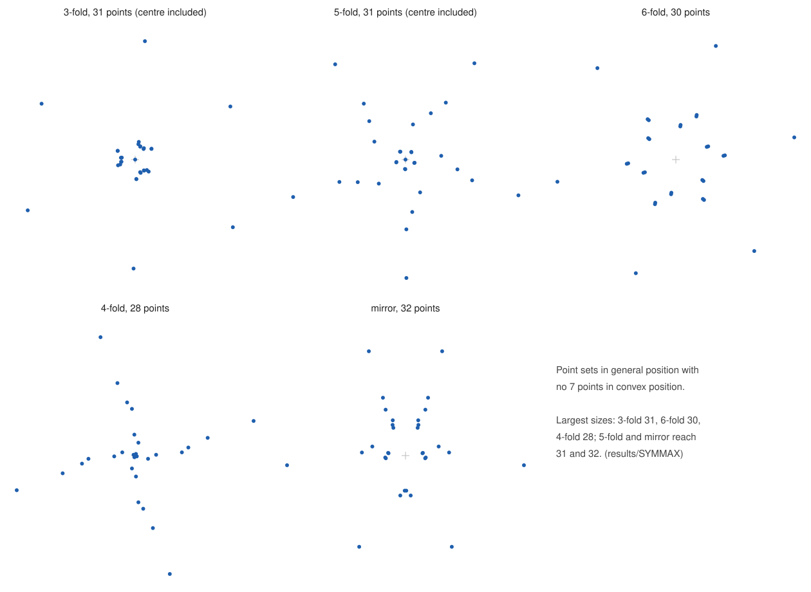

# SYMMAX: the largest symmetric point sets without a convex 7-gon

README revised 1 November 2026 (UTC). Paths are relative to `cloud/es7-2026-10-19/results`.

For a symmetry type, N(type) is the largest number of points in general position with that symmetry and no 7 points in
convex position. All point files here have been checked exactly (see Verification).

| symmetry | possible sizes | example here | upper bound | N |
|---|---|---|---|---|
| 3-fold rotation | 3m, 3m+1 (centre allowed) | `c3_31points.txt` (31, with centre) | 32 is not a possible size; every set with at least 33 points contains a 33-point 3-fold set, excluded by `C3FINAL` | **31** |
| 6-fold rotation | 6m (no centre) | `c6_30points.txt` (30) | a consequence of the 3-fold result: a 36-point 6-fold set contains a 33-point 3-fold set | **30** |
| 4-fold rotation | 4m (no centre) | `c4_28points.txt` (28) | 32 points: stated by Subercaseaux, Mackey, Qian and Heule (arXiv 2506.00224, §6.2; the arXiv version gives no method for its last, unrealizability step; they also report realizable 28-point restrictions) and certified in `C4CUT` (certificate accepted by both checkers); larger sets contain 8 orbits | **28** (the statement is theirs; our file is an explicit realization) |
| 2-fold rotation (central symmetry) | 2m (no centre) | `SYM2/sym7_32points.txt` (32; an explicit case of the Valtr construction described by Baek and Balko, see `SYM2`) | 34 points: excluded (`C2FINAL`); larger sets contain 17 antipodal pairs | **32** |
| 5-fold rotation | 5m, 5m+1 (centre allowed) | `c5_31points.txt` (31, with centre) | 32 to 34 are not possible sizes; 35 or more points: excluded (`SYM5`). This also follows from an earlier reported computation of B. C. Dumitru (arXiv:2512.24061, §7, Table 1, row 5^6, baseline), whose proofs and logs are not public | **31** |
| mirror | 2m + b, b <= 2 points on the axis | `mirror_32points.txt` (32, no point on the axis) | at most 32 points: implied by Baek's theorem (arXiv:2206.04260, Thm 1.6; Eur. J. Combin. 124 (2025) 104085) through the mirror reduction (`WRITEUP/SYMMETRIC.md`, Theorem 2; Lean-checked in `SYMLEAN/mirror`); independent SAT proofs for 33 points with one point on the axis (`WRITEUP/MIRROR.md`; `SYMZ`) and 34 points with none (`SYMZ`) | **32** |
| rotation of order 7 or more | | | every orbit other than the centre is a regular polygon with at least 7 vertices | 1 (the centre alone) |

An even-order rotation contains the half-turn, so a centre point would be collinear with every pair p, -p. That is why
those sizes are multiples of the order.

The 2-fold and mirror rows both reach 32, the largest size any 7-gon-free set can have if ES(7) = 33, and 32 is the
proven maximum for both. The 2-fold example is the explicit construction of `SYM2`. The mirror example was found by
search; a 32-point mirror set also follows from the classical construction in Lovász's form (Morris–Soltan 2000,
Thm 2.6) with the cluster at angle −θ chosen as the mirror image of the cluster at θ (for k = 7 no cluster lies on the
axis). arXiv 2506.00224 treats only rotations.

Also here: two further 3-fold sets, `c3_30points.txt` (30, no centre) and `c3_27points.txt` (27).

## What the symmetric results cover

Every set of at least 33 points in general position with a nontrivial isometric or affine symmetry contains 7 points in
convex position (`WRITEUP/SYMMETRIC.md`, Theorem A; the reduction is Lean-checked in `SYMLEAN`). So a counterexample to
ES(7) = 33, of any size, has no symmetry. The cases:
- a 3-fold rotation: the set contains a 33-point 3-fold set (`C3FINAL`);
- a mirror: at most 32 points by Baek's theorem and the mirror reduction; independently, the set contains a 33-point
  mirror set with one axis point or a 34-point one with none (`SYMZ`);
- a 5-fold rotation: `SYM5`;
- a rotation of even order, including 4 and 6: the set contains 17 antipodal pairs (`C2FINAL`);
- a rotation of order 7 or more: an orbit is a convex polygon with at least 7 vertices.

At exactly 33 points only the 3-fold and mirror cases occur. Of the table, only N(C4) = 28 needs the 32-point fourfold
certificate (`C4CUT`).

## Coordinates

`c3_27points.txt` 27 points, |coordinate| <= 287; `c3_30points.txt` 30 points, |coordinate| <= 306; `c3_31points.txt` 31 points, |coordinate| <= 1017; `c4_28points.txt` 28 points, |coordinate| <= 147; `c6_30points.txt` 30 points, |coordinate| <= 456; `mirror_32points.txt` 32 points, |coordinate| <= 614.

- 5-fold file: a line c0 c1 c2 c3 is the point c0 + c1 z + c2 z² + c3 z³ with z = e^(2πi/5). The rotation by 72° is
  multiplication by z. Orientations are decided exactly: Im(w)/sin 72° = ((2(w1 - w4) - (w2 - w3)) + (w2 - w3)√5)/2
  (`verify5.py`, `anneal5.c`, `shrink5.py`). The data files do not repeat this convention; with another primitive fifth
  root of unity they describe a different set.
- 4-fold and mirror files: ordinary integer coordinates, rotation (x, y) -> (-y, x), mirror (x, y) -> (-x, y).
- 3-fold and 6-fold files: Eisenstein coordinates. A line (a, b) is the point a + b·w, w = e^(2πi/3), that is the plane
  point (a - b/2, b·√3/2). This map is linear and invertible, so collinearity and convex position are decided exactly on
  the integer pairs. In these coordinates the rotation by 120° is (a, b) -> (-b, a - b), and the rotation by 60° is
  (a, b) -> (a - b, a).

## Verification

- `python3 verifyg.py G FILE 7`, with G in {3, 4, 6, 2, M}. It checks, with exact integer arithmetic: distinct points,
  invariance under the symmetry, no three collinear, and the largest subset in convex position (dynamic program in
  `convex.py`). It also writes `FILE.orient`.
- `brute.c` (`cc -O2 -o brute brute.c; ./brute 7 < FILE.orient`): an independent brute force over every 7-point subset
  (a subset is in convex position iff no point lies in a triangle of three others).
  - c3_31points: 2,629,575 subsets, 0 convex.
  - c3_30points: 2,035,800, 0.
  - c3_27points: 888,030, 0.
  - c4_28points: 1,184,040, 0.
  - c6_30points: 2,035,800, 0.
  - mirror_32points: 3,365,856, 0.
  - c5_31points (`python3 verify5.py c5_31points.txt 7`): 2,629,575, 0.
  - c5_30points: 2,035,800, 0.
- The audit of 1 November (`AUDIT3`, A7) re-checked all example files with its own exact code: symmetry and orbit
  structure, general position, and the largest convex subset by a dynamic program in four orders and by exhaustive
  enumeration. All counts above were reproduced.

## How they were found

`annealg.c`: simulated annealing on the orbit representatives (integer coordinates, the orbit rebuilt exactly by the
symmetry map). The cost is the exact number of convex 7-gons, by a dynamic program. Runs: 2026-10-28 on one machine.
Time to the first zero-cost set:
- 3-fold 27: under 1 minute.
- 3-fold 30: 1 to 3 minutes.
- 3-fold 31: about 3 minutes.
- 4-fold 28: 1 second.
- 6-fold 30: about 10 seconds.
- mirror 32: 22 seconds.
- 5-fold 30: 29 seconds.
- 5-fold 31: about 6.5 minutes (two of three runs).

`shrink.py` (`shrink5.py` for 5-fold) then scaled the representatives down while all checks still passed.

Calibration against arXiv 2506.00224, §6.1 (16 points, no convex hexagon; 90 seconds per run). The search finds 4-fold
and 5-fold (with centre) sets, which the paper also found. For 3-fold with centre it stops at one convex hexagon, and the
paper shows no such set exists. A control run on 3-fold 33-point sets with no convex 7-gon, impossible by
`C3FINAL`, never got below 3 convex 7-gons in more than an hour.

## Hexagons (k = 6), for comparison

The largest symmetric sets with no convex hexagon (ES(6) = 17, so 16 is the most possible). Files are in `k6/`.

| symmetry | largest size | |
|---|---|---|
| 2-fold | 16 | `k6/c2_16points.txt` |
| 4-fold | 16 | `k6/c4_16points.txt` (as in arXiv 2506.00224, §6.1) |
| 5-fold | 16 | `k6/c5_16points.txt`, with centre (as in arXiv 2506.00224) |
| 3-fold | **13** | `k6/c3_13points.txt` (with centre); 14 is not a possible size; 15 and 16 are impossible: `../tools/symmetric/symcnf.py 15 6 3` and `16 6 3 --center-in-set` (`k6/*.cnf.gz`) are UNSAT, with LRAT proofs accepted by lrat-check and cake_lpr |
| 6-fold | 1 | every 6-point orbit is a regular hexagon |
| mirror | **12** | `k6/mirror_12points.txt` (5 mirror pairs and 2 points on the axis); the bound is the lemma below |

**Lemma (mirror sets).** Let S be in general position and symmetric under the reflection in a line l. Let R be the
points of S strictly on one side of l, read in the order of their projections to l (distinct, by general position).
If p1, ..., pj in R form a chain that bulges away from l (each middle point farther from l than the chord of its
neighbours), then these points and their mirror images are 2j points in convex position.

Proof. Go around p1, ..., pj, then the mirror images in reverse order. This closed polygon is monotone in the direction
of l (the projections increase along the chain and decrease along the images), hence simple. Every turn is to the same
side. Along the chain this holds because the chain bulges outward, and along the images by symmetry. At pj and p1 the
edge to the mirror image is perpendicular to l, and cross(pj - pj-1, pj' - pj) = 2·dist(pj, l)·(projection gap) > 0.
A simple polygon whose turns all have the same sign is convex, so its vertices are in convex position. (A chain may also
end on l; then that end point counts once. See `WRITEUP/note`, Lemma `lem:mirror`.)

Consequences. For k = 6, no 3-chain of R bulges outward, so every triple of R bends toward l. Then R is a single convex
chain, so |R| <= 5, and |S| <= 2·5 + 2 = 12. For even k = 2j in general, R has no outward j-chain and no k-chain in
convex position, so |R| <= C(3j-4, 2j-2) by the cups-caps theorem. For k = 8 this gives |S| <= 2·28 + 2 = 58 < 64: no
mirror-symmetric set of 64 points avoids a convex octagon. For odd k = 7 the lemma with the cups-caps theorem gives
only |S| <= 44. With Baek's theorem (at most 16 points without a 4-cap and without a convex n-gon for n = 7, at most 22
for n = 8) and the treatment of axis points in `WRITEUP/SYMMETRIC.md` (Theorem 2), the bounds become 32 for k = 7 and
46 for k = 8; both are corollaries of Baek's theorem and are Lean-checked in `SYMLEAN/mirror`. 32 is attained by
`mirror_32points.txt`, and 46 by a set in `MIRRORETV` (exact computation).
