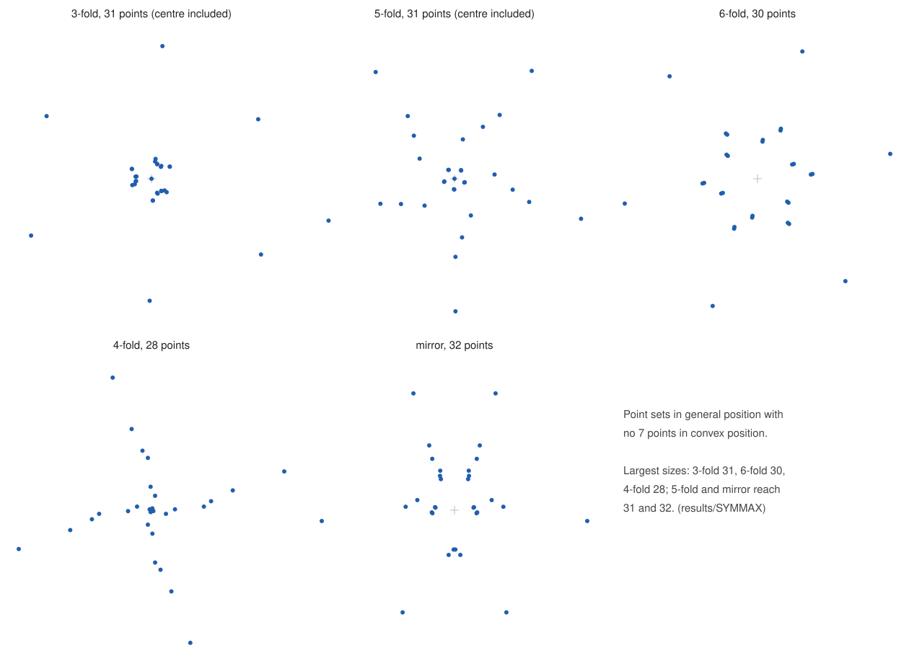

# SYMMAX: the largest symmetric point sets without a convex 7-gon

For a symmetry type, N(type) is the largest number of points in general position with that symmetry and no 7 points in
convex position. All point files here have been checked exactly (see Verification).

| symmetry | possible sizes | example here | upper bound | N |
|---|---|---|---|---|
| 3-fold rotation | 3m, 3m+1 (centre allowed) | `c3_31points.txt` (31, with centre) | 32 is not a possible size; every set with at least 33 points contains a 33-point 3-fold set, excluded by `results/C3FINAL` | **31** |
| 6-fold rotation | 6m (no centre) | `c6_30points.txt` (30) | a 36-point 6-fold set contains a 33-point 3-fold set | **30** |
| 4-fold rotation | 4m (no centre) | `c4_28points.txt` (28) | no 32-point 4-fold set exists (Subercaseaux, Mackey, Qian, Heule, arXiv 2506.00224, §6.2); larger sets contain one | **28** (with their result) |
| 2-fold rotation (central symmetry) | 2m (no centre) | `results/SYM2/sym7_32points.txt` (32) | a 34-point set would refute ES(7) = 33; not excluded | at least 32, and exactly 32 if ES(7) = 33 |
| 5-fold rotation | 5m, 5m+1 (centre allowed) | `c5_31points.txt` (31, with centre) | 32 to 34 are not possible sizes; 35 or 36 points would refute ES(7) = 33 | at least 31, and exactly 31 if ES(7) = 33 |
| mirror | 2m + b, b <= 2 points on the axis | `mirror_32points.txt` (32, no point on the axis) | 33 points with one point on the axis: excluded (`results/FINAL`, `results/WRITEUP/MIRROR.md`); 34 points with no point on the axis would refute ES(7) = 33, not excluded | at least 32, and exactly 32 if ES(7) = 33 |
| rotation of order 7 or more | | | every orbit is a convex polygon with at least 7 vertices | none |

An even-order rotation contains the half-turn, so a centre point would be collinear with every pair p, -p. That is why
those sizes are multiples of the order.

The 2-fold and mirror rows both reach 32, the largest size any 7-gon-free set can have if ES(7) = 33. The 2-fold example
is the explicit construction of `results/SYM2`; the mirror example was found by search. The paper above treats only
rotations.

Also here: two further 3-fold sets, `c3_30points.txt` (30, no centre) and `c3_27points.txt` (27).

## What the 33-point theorem covers, and what it does not

`results/C3FINAL` with the mirror class gives: every set of 33 points in general position with a nontrivial symmetry
contains 7 points in convex position. So a 33-point counterexample to ES(7) = 33 has no symmetry.

A symmetric set with more than 33 points and no convex 7-gon would refute ES(7) = 33 too. Such sets are excluded here in
three cases: when they have a 3-fold rotation (they contain a 33-point 3-fold set); when they have a mirror with at
least one point on the axis (they contain a 33-point mirror set with one axis point); and, by the result above, when
they have a 4-fold rotation. Not excluded: centrally symmetric sets of 34 or more points, mirror-symmetric sets with no
point on the axis (even size, 34 or more), and 5-fold sets of 35 or more points.

## Coordinates

`c3_27points.txt` 27 points, |coordinate| <= 287; `c3_30points.txt` 30 points, |coordinate| <= 306; `c3_31points.txt` 31 points, |coordinate| <= 1017; `c4_28points.txt` 28 points, |coordinate| <= 147; `c6_30points.txt` 30 points, |coordinate| <= 456; `mirror_32points.txt` 32 points, |coordinate| <= 614.

- 5-fold file: a line c0 c1 c2 c3 is the point c0 + c1 z + c2 z² + c3 z³ with z = e^(2πi/5). The rotation by 72° is
  multiplication by z. Orientations are decided exactly: Im(w)/sin 72° = ((2(w1 - w4) - (w2 - w3)) + (w2 - w3)√5)/2
  (`verify5.py`, `anneal5.c`, `shrink5.py`).
- 4-fold and mirror files: ordinary integer coordinates, rotation (x, y) -> (-y, x), mirror (x, y) -> (-x, y).
- 3-fold and 6-fold files: Eisenstein coordinates. A line (a, b) is the point a + b·w, w = e^(2πi/3), that is the plane
  point (a - b/2, b·√3/2). This map is linear and invertible, so collinearity and convex position are decided exactly on
  the integer pairs. In these coordinates the rotation by 120° is (a, b) -> (-b, a - b), and the rotation by 60° is
  (a, b) -> (a - b, a).

## Verification

- `python3 verifyg.py G FILE 7`, with G in {3, 4, 6, 2, M}. It checks, with exact integer arithmetic: distinct points,
  invariance under the symmetry, no three collinear, and the largest subset in convex position (dynamic program in
  `convex.py`). It also writes `FILE.orient`.
- `brute.c` (`cc -O2 -o brute brute.c; ./brute 7 < FILE.orient`): an independent brute force over every 7-point subset
  (a subset is in convex position iff no point lies in a triangle of three others).
  - c3_31points: 2,629,575 subsets, 0 convex.
  - c3_30points: 2,035,800, 0.
  - c3_27points: 888,030, 0.
  - c4_28points: 1,184,040, 0.
  - c6_30points: 2,035,800, 0.
  - mirror_32points: 3,365,856, 0.
  - c5_31points (`python3 verify5.py c5_31points.txt 7`): 2,629,575, 0.
  - c5_30points: 2,035,800, 0.

## How they were found

`annealg.c`: simulated annealing on the orbit representatives (integer coordinates, the orbit rebuilt exactly by the
symmetry map). The cost is the exact number of convex 7-gons, by a dynamic program. Runs: 2026-10-28 on one machine.
Time to the first zero-cost set:
- 3-fold 27: under 1 minute.
- 3-fold 30: 1 to 3 minutes.
- 3-fold 31: about 3 minutes.
- 4-fold 28: 1 second.
- 6-fold 30: about 10 seconds.
- mirror 32: 22 seconds.
- 5-fold 30: 29 seconds.
- 5-fold 31: about 6.5 minutes (two of three runs).

`shrink.py` (`shrink5.py` for 5-fold) then scaled the representatives down while all checks still passed.

Calibration against arXiv 2506.00224, §6.1 (16 points, no convex hexagon; 90 seconds per run). The search finds 4-fold
and 5-fold (with centre) sets, which the paper also found. For 3-fold with centre it stops at one convex hexagon, and the
paper shows no such set exists. A control run on 3-fold 33-point sets with no convex 7-gon, impossible by
`results/C3FINAL`, never got below 3 convex 7-gons in more than an hour.

## Hexagons (k = 6), for comparison

The largest symmetric sets with no convex hexagon (ES(6) = 17, so 16 is the most possible). Files are in `k6/`.

| symmetry | largest size | |
|---|---|---|
| 2-fold | 16 | `k6/c2_16points.txt` |
| 4-fold | 16 | `k6/c4_16points.txt` (as in arXiv 2506.00224, §6.1) |
| 5-fold | 16 | `k6/c5_16points.txt`, with centre (as in arXiv 2506.00224) |
| 3-fold | **13** | `k6/c3_13points.txt` (with centre); 14 is not a possible size; 15 and 16 are impossible: `tools/symmetric/symcnf.py 15 6 3` and `16 6 3 --center-in-set` (`k6/*.cnf`) are UNSAT, with LRAT proofs accepted by lrat-check and cake_lpr |
| 6-fold | 1 | every 6-point orbit is a regular hexagon |
| mirror | **12** | `k6/mirror_12points.txt` (5 mirror pairs and 2 points on the axis); the bound is the lemma below |

**Lemma (mirror sets).** Let S be in general position and symmetric under the reflection in a line l. Let R be the
points of S strictly on one side of l, read in the order of their projections to l (distinct, by general position).
If p1, ..., pj in R form a chain that bulges away from l (each middle point farther from l than the chord of its
neighbours), then these points and their mirror images are 2j points in convex position.

Proof. Going around p1, ..., pj, then the mirror images in reverse order, every turn is to the same side. Along the chain
this holds because the chain bulges outward. At pj and p1 the edge to the mirror image is perpendicular to l, and
cross(pj - pj-1, pj' - pj) = 2·dist(pj, l)·(projection gap) > 0.

Consequences. For k = 6, no 3-chain of R bulges outward, so every triple of R bends toward l. Then R is a single convex
chain, so |R| <= 5, and |S| <= 2·5 + 2 = 12. For even k = 2j in general, R has no outward j-chain and no k-chain in
convex position, so |R| <= C(3j-4, 2j-2) by the cups-caps theorem. For k = 8 this gives |S| <= 2·28 + 2 = 58 < 64: no
mirror-symmetric set of 64 points avoids a convex octagon. For odd k = 7 the lemma only gives |S| <= 44, and 32 is
reached.
